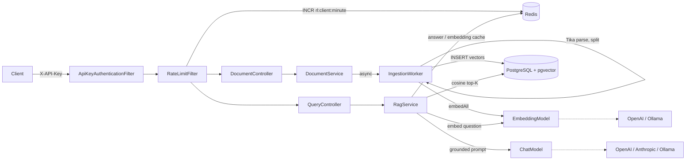

# AI Document Intelligence Platform (RAG)

A Retrieval-Augmented Generation (RAG) backend. You upload documents, it splits them into chunks, embeds them and stores the vectors in PostgreSQL with pgvector. You then ask questions over a REST API and get answers grounded in your documents, with numbered citations back to the exact source chunks.

**Stack:** Java 25 · Spring Boot 4.1 · LangChain4j 1.22 · PostgreSQL 17 + pgvector · Redis 7 · Flyway · Docker

**Features**

- Document ingestion for PDF, DOCX, PPTX, HTML, TXT, Markdown and more (Apache Tika), run asynchronously with status tracking.
- Vector search with cosine similarity on pgvector, using an HNSW index.
- Answers grounded in your documents, with `[n]` citations and the matching source excerpts.
- No LLM call when nothing relevant is found, so the model can't invent an answer.
- Pluggable models: OpenAI, Anthropic Claude or Ollama (local) for chat; OpenAI or Ollama for embeddings.
- API-key authentication, with each API key acting as an isolated tenant.
- Per-client rate limiting backed by Redis, with `X-RateLimit-*` headers.
- Redis caching for question embeddings and full answers, with O(1) invalidation.
- OpenAPI / Swagger UI, health probes and RFC 9457 error responses.
- Multi-stage, non-root Docker image and a docker-compose stack.

---

## Contents

1. [Architecture](#architecture)
2. [Quick start (Docker)](#quick-start-docker)
3. [Local development](#local-development)
4. [Configuration](#configuration)
5. [API reference](#api-reference)
6. [How it works](#how-it-works)
7. [Security model](#security-model)
8. [Operations](#operations)
9. [Testing](#testing)
10. [Troubleshooting](#troubleshooting)
11. [Limitations and next steps](#limitations-and-next-steps)

---

## Architecture



| Package (`com.ai.documentintelligence`) | Responsibility |
|---|---|
| `config` | Typed configuration (`AppProperties`), LLM model beans, security chain, async executor, OpenAPI |
| `security` | API-key registry and filter, Redis rate limiter and filter, problem-JSON writer |
| `document` | Document entity and repository, upload/list/delete API, async ingestion pipeline |
| `vector` | pgvector access through JDBC (`ChunkRepository`) |
| `rag` | Query API, retrieval and generation pipeline, prompt and citation handling |
| `cache` | Redis embedding cache, answer cache and corpus-version invalidation |
| `common` | Exceptions, global error handler, hashing |

**Data model** (Flyway migration `V1__init_schema.sql`):

- `documents`: one row per uploaded file. Holds the owner (tenant), filename, SHA-256, `status` (`PENDING`, `PROCESSING`, `READY` or `FAILED`), error message and chunk count.
- `document_chunks`: one row per chunk. Holds `content`, `embedding vector(N)` and `chunk_index`, has a foreign key to `documents` with `ON DELETE CASCADE`, and an HNSW index using `vector_cosine_ops`.

---

## Quick start (Docker)

Prerequisites: Docker with Compose v2, and an OpenAI API key (or use [fully local Ollama](#option-c-fully-local-with-ollama)).

```bash
cp .env.example .env
# edit .env: set APP_API_KEY (16+ chars) and OPENAI_API_KEY
docker compose up -d --build
docker compose logs -f app          # wait for "Started AiDocumentIntelligenceApplication"
```

Then try it:

```bash
export KEY=change-me-to-a-long-random-string     # your APP_API_KEY

# 1. Upload a document -> 202 Accepted, status PENDING
curl -s -H "X-API-Key: $KEY" -F "file=@./contract.pdf" http://localhost:8080/api/v1/documents

# 2. Poll until status is READY
curl -s -H "X-API-Key: $KEY" http://localhost:8080/api/v1/documents/<id>

# 3. Ask a question
curl -s -H "X-API-Key: $KEY" -H "Content-Type: application/json" \
     -d '{"question":"What is the notice period for termination?"}' \
     http://localhost:8080/api/v1/query
```

- Swagger UI: <http://localhost:8080/swagger-ui.html>. Click **Authorize** and paste your API key.
- Health: <http://localhost:8080/actuator/health>

### Option B: Anthropic Claude for answers

Anthropic doesn't offer an embeddings API, so keep OpenAI or Ollama for embeddings and switch only the chat model:

```env
CHAT_PROVIDER=anthropic
CHAT_MODEL=claude-sonnet-5-5
CHAT_API_KEY=sk-ant-...
OPENAI_API_KEY=sk-...        # still used for embeddings
```

### Option C: fully local with Ollama

```bash
# in .env: uncomment the "Option C" block (sets EMBEDDING_DIMENSION=768)
docker compose --profile ollama up -d --build
docker compose exec ollama ollama pull llama3.2
docker compose exec ollama ollama pull nomic-embed-text
docker compose restart app
```

> ⚠️ The embedding dimension is fixed in the database the first time the app starts. If you switch between OpenAI (1536) and Ollama (768), see [Changing the embedding model](#changing-the-embedding-model).

---

## Local development

Prerequisites: JDK 25 or newer. Maven isn't needed because the `mvnw` wrapper is included.

```bash
# Start only the infrastructure
docker compose up -d postgres redis

# Run the app from source (PowerShell: $env:APP_API_KEY="..." etc.)
export APP_API_KEY=dev-key-please-change-0001
export OPENAI_API_KEY=sk-...
./mvnw spring-boot:run          # Windows: mvnw.cmd spring-boot:run
```

Without environment variables, the defaults in `application.yml` point to `localhost:5432` (database, user and password all `docintel`) and `localhost:6379`.

| Task | Command |
|---|---|
| Run tests | `./mvnw test` |
| Build jar | `./mvnw -DskipTests package`, which produces `target/document-intelligence-0.0.1-SNAPSHOT.jar` |
| Build image | `docker build -t ai-document-intelligence .` |

---

## Configuration

All settings are in [`src/main/resources/application.yml`](src/main/resources/application.yml) under `app.*` and bind to the typed record [`AppProperties`](src/main/java/com/ai/documentintelligence/config/AppProperties.java). Each setting can be overridden with the environment variable shown, or with Spring relaxed binding (for example `APP_RAG_MIN_SCORE=0.4`).

### Core

| Env var | Default | Meaning |
|---|---|---|
| `APP_API_KEY` | *(empty)* | API key for the default client (16+ chars). If it's empty, every request is rejected. |
| `APP_API_KEY_NAME` | `default` | Client/tenant name for that key |
| `RATE_LIMIT_RPM` | `60` | Requests per minute per client |
| `DB_URL` / `DB_USERNAME` / `DB_PASSWORD` | `localhost` / `docintel` / `docintel` | PostgreSQL connection |
| `REDIS_HOST` / `REDIS_PORT` / `REDIS_PASSWORD` | `localhost` / `6379` / empty | Redis connection |
| `MAX_UPLOAD_SIZE` | `20MB` | Maximum upload size |
| `PORT` | `8080` | HTTP port |

### Models

| Env var | Default | Meaning |
|---|---|---|
| `CHAT_PROVIDER` | `openai` | `openai`, `anthropic` or `ollama` |
| `CHAT_MODEL` | `gpt-4.1-mini` | Model name for that provider |
| `CHAT_API_KEY` | falls back to `OPENAI_API_KEY` | Provider API key |
| `CHAT_BASE_URL` | empty | Required for Ollama. Optional for OpenAI-compatible gateways. |
| `EMBEDDING_PROVIDER` | `openai` | `openai` or `ollama` |
| `EMBEDDING_MODEL` | `text-embedding-3-small` | Embedding model |
| `EMBEDDING_API_KEY` | falls back to `OPENAI_API_KEY` | |
| `EMBEDDING_BASE_URL` | empty | Required for Ollama |
| `EMBEDDING_DIMENSION` | `1536` | **Must match the model.** Fixed when the database is first created. |

### Tuning (`app.*` in application.yml)

| Property | Default | Meaning |
|---|---|---|
| `app.ingestion.chunk-size` | 1000 | Characters per chunk |
| `app.ingestion.chunk-overlap` | 150 | Overlap between neighbouring chunks |
| `app.ingestion.embed-batch-size` | 64 | Chunks per embedding API call |
| `app.ingestion.concurrency` / `queue-capacity` | 2 / 100 | Parallel ingestion jobs and how many can queue. When the queue is full, uploads get 503. |
| `app.rag.default-top-k` / `max-top-k` | 5 / 20 | Chunks retrieved per question |
| `app.rag.min-score` | 0.3 | Cosine similarity floor. If no chunk passes it, the LLM isn't called. |
| `app.cache.enabled` | true | Turns Redis caching on or off |
| `app.cache.answer-ttl` / `embedding-ttl` | 1h / 24h | Cache lifetimes |

### Multiple clients (tenants)

Add entries to `app.security.api-keys` (YAML or env `APP_SECURITY_API_KEYS_1_NAME`, `..._1_KEY`, `..._1_REQUESTS_PER_MINUTE`):

```yaml
app:
  security:
    api-keys:
      - name: acme
        key: ${ACME_KEY}
      - name: globex
        key: ${GLOBEX_KEY}
        requests-per-minute: 300
```

Each `name` sees only its own documents.

---

## API reference

All `/api/**` endpoints need the `X-API-Key` header. Errors use `application/problem+json`. The full schema is at `/v3/api-docs`.

### `POST /api/v1/documents` — upload a file

`multipart/form-data` with the field `file`.

| Status | Meaning |
|---|---|
| `202 Accepted` | New document, queued for ingestion (`status: PENDING`) |
| `200 OK` | You already uploaded identical content. The existing document is returned. |
| `400` | Empty file |
| `413` | File too large |
| `503` | Ingestion queue is full, retry later |

```json
{
  "id": "6f1c8a1e-3a51-4c43-9d1e-0b3c6a0f7f10",
  "filename": "contract.pdf",
  "contentType": "application/pdf",
  "sizeBytes": 183422,
  "status": "PENDING",
  "chunkCount": 0,
  "errorMessage": null,
  "createdAt": "2026-11-06T09:12:44.120Z",
  "updatedAt": "2026-11-06T09:12:44.120Z"
}
```

### `POST /api/v1/documents/text` — ingest raw text

```json
{ "title": "Leave policy", "content": "Employees get 24 days of paid leave..." }
```

The responses are the same as for file upload.

### `GET /api/v1/documents?page=0&size=20` — list your documents

Lists newest first and returns `{ items, page, size, totalItems, totalPages }`.

### `GET /api/v1/documents/{id}` — get a document

Use this to poll ingestion: `PENDING` → `PROCESSING` → `READY` or `FAILED` (check `errorMessage`).

### `DELETE /api/v1/documents/{id}` — delete

Returns `204`. Removes the document and all of its chunks, and invalidates your cached answers.

### `POST /api/v1/query` — ask a question

```json
{
  "question": "What is the notice period for termination?",
  "topK": 5,
  "minScore": 0.3,
  "documentIds": ["6f1c8a1e-3a51-4c43-9d1e-0b3c6a0f7f10"]
}
```

Only `question` is required. `documentIds` restricts the search to those documents.

```json
{
  "answer": "Either party may terminate with 30 days' written notice [1]. During probation the notice period is 7 days [2].",
  "grounded": true,
  "sources": [
    {
      "index": 1,
      "documentId": "6f1c8a1e-...",
      "filename": "contract.pdf",
      "chunkIndex": 14,
      "score": 0.8123,
      "cited": true,
      "excerpt": "12.1 Either party may terminate this Agreement by giving thirty (30) days' written notice..."
    }
  ],
  "model": "gpt-4.1-mini",
  "cached": false,
  "latencyMs": 1840
}
```

- `grounded` is `false` when nothing relevant was found or the model said it couldn't answer from the sources. Your UI should treat those answers differently.
- `sources[].cited` shows which retrieved chunks the answer actually used.
- `cached: true` means Redis served the answer.

### Rate limit headers

Every authenticated response includes `X-RateLimit-Limit`, `X-RateLimit-Remaining` and `X-RateLimit-Reset` (seconds until the window resets). A `429` response also includes `Retry-After`.

### Public endpoints

`/actuator/health`, `/actuator/health/liveness`, `/actuator/health/readiness`, `/actuator/info`, `/swagger-ui.html`, `/v3/api-docs`.

---

## How it works

### Ingestion ([`IngestionWorker`](src/main/java/com/ai/documentintelligence/document/IngestionWorker.java))

1. The upload is hashed with SHA-256. If the same client already uploaded the same content and that document isn't `FAILED`, the existing document is returned.
2. A `documents` row is committed as `PENDING`, and the job goes onto a bounded thread pool.
3. **Parse:** Apache Tika extracts plain text. Scanned PDFs with no text layer fail with a clear message.
4. **Split:** LangChain4j's recursive splitter breaks the text into chunks of about 1000 characters with 150 characters of overlap. It splits on paragraphs, then lines, then sentences, then words, so chunks keep meaning together.
5. **Embed:** chunks are embedded in batches of 64.
6. **Store:** inserting the chunks and marking the document `READY` happen in one transaction, so a document is never `READY` with only some of its chunks.
7. The owner's corpus version in Redis is incremented, which invalidates their cached answers.

If the app restarts mid-job, the in-flight documents are marked `FAILED` on the next startup, because the uploaded bytes aren't persisted.

### Query ([`RagService`](src/main/java/com/ai/documentintelligence/rag/RagService.java))

1. **Answer cache:** the key is `ans:{owner}:{corpusVersion}:{sha256(normalised question, topK, minScore, documentIds)}`. On a hit the cached answer is returned.
2. **Embed the question.** Embeddings are cached under `emb:{model}:{sha256(question)}`.
3. **Retrieve:** a cosine top-K search on pgvector over the caller's `READY` documents:
   ```sql
   SELECT ..., 1 - (embedding <=> :q) AS score
   FROM document_chunks c JOIN documents d ...
   WHERE c.owner = :owner AND d.status = 'READY'
   ORDER BY embedding <=> :q LIMIT :k
   ```
   Chunks below `minScore` are dropped.
4. **No context, no LLM:** if nothing passes the threshold, the API returns *"I could not find the answer in the provided documents."* with `grounded: false`.
5. **Generate:** the system prompt requires the model to answer only from the numbered `<source>` blocks, cite each claim as `[n]`, use the fixed "not found" sentence when the sources are insufficient, and ignore any instructions that appear inside sources (a basic guard against prompt injection).
6. **Post-process:** `[n]` citations are parsed out of the answer, each source gets its `cited` flag, and the response is cached.

### Caching and invalidation

Each owner has a Redis counter, `corpus:{owner}`, that is part of every answer-cache key. Uploading or deleting a document increments the counter, so all of that owner's old answers become unreachable at once, with no key scanning. The old entries expire through their TTL. Redis is configured with `allkeys-lru` in compose.

Redis is an optimisation, not a hard dependency. If Redis is down, cache reads count as misses and the rate limiter fails open (allows requests). A warning is logged in both cases.

---

## Security model

- **Authentication:** clients send `X-API-Key`. The server keeps only SHA-256 digests of the configured keys and looks up the digest of the presented key, so raw secrets are never compared directly. Keys shorter than 16 characters and duplicate keys are rejected at startup.
- **Tenant isolation:** the key's `name` is the owner. Every document query and every vector search filters on `owner`, and requests for another tenant's document ID return `404`.
- **Rate limiting:** a fixed one-minute window per client, implemented as an atomic Redis Lua `INCR` + `EXPIRE`. It works across multiple app replicas.
- **Stateless:** no sessions, no CSRF tokens, no cookies. Every route outside `/api/**`, the health/info probes and the docs is denied.
- **Input hygiene:** Bean Validation on request bodies, a configurable upload size limit, sanitised filenames (path components and control characters removed), and source text escaped inside prompt tags.
- **Container:** runs as a non-root user. Secrets come from the environment or `.env`, which is in `.gitignore`.

For production: put the service behind TLS (a reverse proxy or ingress), use long random keys (`openssl rand -hex 32`), rotate them by adding the new key before removing the old one, and don't publish the Postgres or Redis ports.

---

## Operations

- **Health:** `/actuator/health` covers the database and disk. Redis is left out on purpose: it is optional at runtime, so its outage must not report the app as down. Kubernetes probes are at `/actuator/health/liveness` and `/actuator/health/readiness`.
- **Logs:** ingestion logs the chunk count and duration for each document. Provider failures are logged at ERROR and return `502` to the client.
- **Startup safety checks:** Flyway applies migrations. `ChunkRepository.verifyDimension()` stops the app if `EMBEDDING_DIMENSION` doesn't match the database column, and documents left in progress from an earlier run are marked `FAILED`.
- **Scaling:** the app is stateless, so you can run more replicas. Rate limits and caches are shared through Redis. Ingestion runs in-process, so each replica processes its own uploads.

### Changing the embedding model

Vectors from different models can't be compared, and the column is `vector(N)`. To switch models:

1. Development: `docker compose down -v` (**this deletes all data**), set the new `EMBEDDING_*` values, then `docker compose up -d`.
2. Production: add a Flyway migration that changes the `embedding` column type to the new dimension and recreates the HNSW index, then re-upload the documents.

---

## Testing

```bash
./mvnw test
```

The tests don't need a database, Redis or an LLM:

| Test | Covers |
|---|---|
| `RagServiceTest` | Grounded answers, citation flags, skipping the LLM when no context is found, cache hits, the top-K cap, provider error wrapping, cache-key normalisation |
| `PromptBuilderTest` | Source numbering, escaping tags and attributes, citation parsing |
| `SecurityWebTest` | Full security filter chain with MockMvc: 401 when the key is missing or wrong, 200 with rate-limit headers, 429 with `Retry-After`, 400 on validation errors |
| `ApiKeyRegistryTest`, `RateLimiterTest` | Key rules, per-client limits, window maths, fail-open behaviour |
| `RagCacheCodecTest`, `SmallUnitsTest`, `DocumentServiceTest` | Embedding codec, pgvector literal, filename sanitising |

For an end-to-end check, use the [Quick start](#quick-start-docker) commands against the compose stack.

---

## Troubleshooting

| Symptom | Cause and fix |
|---|---|
| `Missing required configuration: app.ai.chat.api-key` at startup | Set `OPENAI_API_KEY` (or `CHAT_API_KEY`) |
| `Database column ... is vector(1536) but app.ai.embedding.dimension=768` | You changed the embedding model. See [Changing the embedding model](#changing-the-embedding-model). |
| Every request returns 401 | `APP_API_KEY` isn't set (the startup log warns about this), or the header name isn't `X-API-Key` |
| Document stuck `FAILED` with "No extractable text" | The file is a scanned or image-only PDF. Run OCR on it first. |
| Answers are always "could not find" | The documents aren't `READY` yet, `minScore` is too high (try 0.2), or the question uses different words than the document |
| `502 Bad Gateway` on query | The LLM or embedding provider failed (quota, key, timeout). Check the app logs. |
| `extension "vector" is not available` | Postgres doesn't have pgvector installed. Use the `pgvector/pgvector` image. |

---

## Limitations and next steps

- Uploaded originals aren't stored. Only the extracted chunks are kept, so re-ingestion needs a re-upload. Possible next step: object storage (S3 or MinIO).
- Ingestion runs in-process. For heavy workloads, move it to a queue (Redis Streams, SQS) with separate workers.
- Retrieval is vector-only. Adding hybrid search (Postgres full-text plus vectors) and a reranker would improve precision.
- No streaming responses (SSE) yet.
- API keys live in configuration. A database-backed key store with an admin API would allow rotation without redeploying.
- With very selective filters (`documentIds`) on large datasets, enable pgvector's iterative index scans (`hnsw.iterative_scan`) to keep recall high.
